# 🤞 Hi, I'm Sahen

A student developer based in Japan, building tools at the edge of Rust and AI.

 

&nbsp;
&nbsp;

 

## Selected work

> **Use of AI:** Most of my projects are built with heavy AI assistance.

<table>
<tr>
<td width="33%" valign="top">

  

<h3 align="center"><a href="https://github.com/jimoto-no-llm/rustdsh">rustdsh</a></h3>

A fast Rust launcher for DeepSeek Harness with sub-millisecond startup — so fast it feels instant.

Rust · CLI · drop-in compatible · top contributor

</td>
<td width="33%" valign="top">

  

<h3 align="center"><a href="https://github.com/sahenjp/lvau">Lvau</a></h3>

Local file encryption across CLI and native GUI, so your data stays yours.

Rust · XChaCha20-Poly1305 · Argon2id · AI: roughly half

</td>
<td width="33%" valign="top">

  &nbsp;

<h3 align="center"><a href="https://github.com/sahenjp/RustXNG">RustXNG</a></h3>

A self-hosted metasearch and web-grounding engine for local AI agents. Searches 180+ engines, ranks results, and retrieves page content in a single request, with built-in SSRF protection.

Rust · Metasearch · AI Infrastructure

</td>
</tr>
</table>

 

## Stack

  
  &nbsp;&nbsp;
  
  &nbsp;&nbsp;
  
  &nbsp;&nbsp;
  
  &nbsp;&nbsp;
  
   
  TypeScript · Rust · Python · React · GitHub

 

## Activity

<picture>
  <source media="(prefers-color-scheme: dark)" srcset="./activity/lifetime.dark.svg" />
  
</picture>

 

## Now playing

  

ニョ
